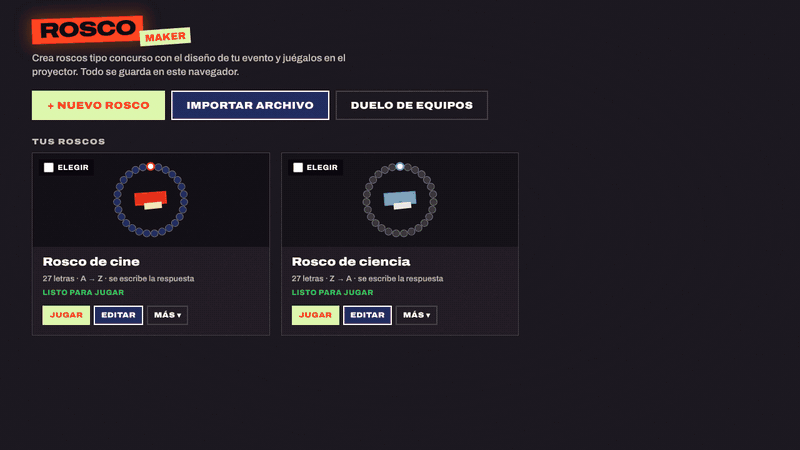
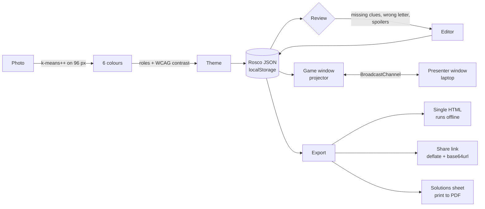

# RoscoMaker

> En español: generador de roscos tipo concurso que saca los colores de una foto, revisa que ninguna pista destripe otra respuesta y exporta un HTML que se juega en el proyector sin internet.



RoscoMaker builds "rosco" rounds, the alphabet-wheel game from Spanish TV quiz shows: one clue per letter, the answer starts with (or contains) that letter, and you go round the wheel until every letter is answered. You give it a photo of your event poster and it builds the theme from its colours, you write the clues, and you get a single HTML file that runs on any laptop plugged into a projector, with no server and no internet.

## Why

I first wrote a one-off rosco for a youth group event: two wheels, 54 clues, a projector and a host reading them out. Three things went wrong while preparing it, and each one became a feature here:

- People type fast and badly. A strict comparison would reject "amelie poulain" for "Amélie Poulain".
- Some clues gave away answers that were still to come. In the first draft, one clue in wheel 1 named the person who was the K answer in wheel 2.
- The host already knew the answers and needed to mark right or wrong from the laptop, without the answer showing up on the projector (so the other team could still steal the point).

## Results

All figures come from `npm run medir`, which writes [`results/medidas.md`](results/medidas.md). The answer tests use the 54 answers of the two example wheels and a fixed random seed.

| What is measured | Result |
| --- | --- |
| Correctly spelled answers accepted (as written, lower case, upper case, no accents) | 100 % |
| Answers of 5+ letters with one typo, accepted without asking the host (860 tries) | 100 % |
| Same test with plain Levenshtein distance | 86 % |
| Answers of 4 letters or fewer with one typo, accepted | 3.6 % (on purpose, see below) |
| Another letter's answer accepted by mistake (1,404 pairs) | 0 % |
| Random synthetic photos whose colour roles meet the contrast minimums (500 photos) | 100 % |
| Share link for a 27-letter wheel, without photo | 2,264 characters |
| Whole app, built (one HTML file with fonts) | 309 KB |

Anything the matcher does not accept is not marked wrong: the game shows what was typed and asks the host "¿Es válida?".

## How it works



**Matching answers** ([`src/corrector.ts`](src/corrector.ts)). Text is lower-cased, accents and punctuation are stripped (the ñ is kept, it is a letter, not an accented n), and a leading article is ignored, so "casa de mis sueños" matches "La casa de mis sueños". Then it allows 0 edits up to 4 letters, 1 up to 8 and 2 beyond. Short words get no tolerance because one edit usually makes another word ("Rut" and "rot"). The distance is restricted Damerau–Levenshtein: swapping two neighbouring letters counts as one edit. With plain Levenshtein, 14 % of the one-typo answers were rejected: all of them were swaps, since that is the only difference between the two distances.

**Spoiler check** ([`src/revision.ts`](src/revision.ts)). The wheels are put in the order they will be played (A→Z or Z→A, wheel 1 then wheel 2) and every clue is searched for any answer that has not come up yet. It also flags a clue that contains a word of its own answer ("What did we do with the costumes?" → "Costume parade").

**Colours from a photo** ([`src/paleta.ts`](src/paleta.ts)). The photo is scaled down to 96 px and grouped into 6 colours with k-means++ and a seeded random generator, so the same photo always gives the same theme. The darkest colour becomes the background, the most saturated one the accent, a colour at least 40° away in hue becomes the letter discs, and a light tint becomes the highlight. Each one is then darkened until white text on it passes the WCAG minimum (with a 0.2 margin, because rounding to hex can lose it).

**One file that copies itself** ([`src/copia.ts`](src/copia.ts), [`src/exportar.ts`](src/exportar.ts)). The build inlines JS, CSS and fonts into `index.html`. The first thing the app does is keep a copy of its own page. Exporting parses that copy with `DOMParser`, adds a `<script type="application/json">` with the wheels and serialises it again. The first version did this with string search and broke: the app's own code contains `</head>` and similar strings, and the minifier joins `'<scr' + 'ipt'`.

**Presenter view** ([`src/vistas/presentador.ts`](src/vistas/presentador.ts)). A second window opened from the game. The two talk through `BroadcastChannel`, so no server is needed. The presenter sees the answer and the alternatives and sends ✓, ✗ or "Pasapalabra"; the projector never shows the answer.

The game logic (`partida.ts`, `duelo.ts`) has no DOM code and is tested on its own. The screens in `src/vistas/` only draw the state and call it.

## What else it does

- Choose which letters to use (all 27, without Ñ, without Ñ/K/W/X/Y, or by hand) and whether each one is "starts with" or "contains".
- Two answer modes: players type the answer, or the host marks ✓ / Pasapalabra / ✗ with the arrow keys.
- Paste clues from Excel, Google Sheets or a CSV. Header names are recognised in any order.
- Two-team duel: each team plays its own wheel, the turn passes on a miss or a pass, and each team's clock only runs on its turn.
- Everything works with the keyboard (← → to choose, Enter to confirm, Esc to leave) and with the mouse.
- Solutions sheet for the host: A4 pages in playing order, ready to print or save as PDF.

## Limitations

- The presenter view only works between two windows of the same browser on the same computer. A phone remote would need a server or WebRTC.
- Wheels are stored in `localStorage` (about 5 MB). Photos are shrunk to 900 px JPEG, but a few dozen wheels with photos can still fill it, and clearing the browser data deletes them. Export to JSON to keep a copy.
- The matcher works on spelling, not meaning. Synonyms and partial answers ("Kevin" for "Kevin McCallister") go to the host.
- The spoiler check only finds literal mentions of an answer after normalising. A surname on its own or a paraphrase is not detected.
- The font cannot be read from the photo. You pick one of four bundled fonts.
- The share link leaves out the background photo; with it, the link would be hundreds of kilobytes long.
- Exporting the offline HTML only works from the built app, not from `npm run dev`, where the page loads separate modules.
- Spanish alphabet only (27 letters, Ñ included).

## Run it

```bash
npm install
npm run dev            # http://localhost:5173
npm test               # logic tests (Vitest)
npm run check          # TypeScript
npm run build          # dist/index.html, the whole app in one file
npm run e2e            # browser tests (Playwright) against the build
npm run medir          # rewrites results/medidas.md and results/medidas.json
python3 scripts/demo.py   # records results/demo.gif (needs Python Playwright, Pillow and ffmpeg)
```

`dist/index.html` can be opened straight from disk. On every push to `main`, the workflow in `.github/workflows/ci.yml` runs the checks and publishes the build to GitHub Pages.

No external data is needed: the example wheels are in [`src/ejemplos.ts`](src/ejemplos.ts) and the tests make their own synthetic images.

## Credits

Fonts: Archivo, Anton, Space Grotesk and Fraunces, under the SIL Open Font License, bundled through [Fontsource](https://fontsource.org). Sounds are generated with the Web Audio API.

"Pasapalabra" is a trademark of its owners. This project is not affiliated with the show and only borrows the general format of the round.

MIT licence.
